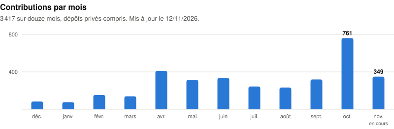
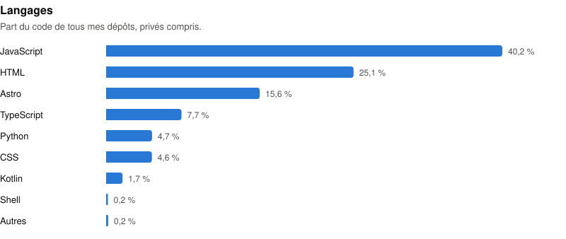

<h1 align="center">François Menguy</h1>

  🇫🇷 Français · 🇬🇧 <a href="#english">English</a>

  <b>Ingénieur DevSecOps et référent IA</b> · Atos, en mission chez Orange · Caen 
  <i>DevSecOps engineer and AI lead · Atos, on assignment at Orange · Caen, France</i>

  
  
  
  
  

---

## À propos

J'aide les équipes à adopter l'IA, je mets des agents IA en production et je suis Security Champion IAM. Ingénieur réseaux et télécoms de formation, je suis en mission chez Orange depuis ma sortie d'école en 2016, avec Altran, puis Capgemini, puis Atos depuis 2022.

IA, sécurité, Kubernetes et CI/CD au quotidien. Romans illustrés, images générées et jeux web le reste du temps.

La plupart de mes dépôts sont privés : leur contenu ne se voit pas, mais leur activité si, [en bas de page](#activite).

## L'IA, au travail et à côté

**Au travail**

- **Référent IA** d'un train SAFe d'une centaine de personnes, pour accompagner les équipes dans l'adoption de l'IA.
- **Formations IA** : une quinzaine de sessions animées, une soixantaine de collègues formés, et une communauté IA lancée en interne.
- **Agents IA en production** et **pipelines RAG** : conversion de documents, découpage, indexation vectorielle, extraction d'entités et de relations par LLM.
- **Audits de conformité IA** au regard de l'AI Act.

**À côté**

- **Développer avec des agents** : ma méthode (un pilote qui cadre, un développeur qui livre, des tests qui tranchent), éprouvée sur Strates, avec les chiffres réels de mon atelier. [fmenguy.fr/ia/agentique](https://fmenguy.fr/ia/agentique)
- **Une veille écrite par des agents** : deux flux hebdomadaires produits par des pipelines d'agents Claude qui cherchent, trient, rédigent et publient seuls, sans retouche. [fmenguy.fr/blog/veille](https://fmenguy.fr/blog/veille/) · [code](https://github.com/fmenguy/veille-auto-multi-agent)
- **Serveurs MCP** : [mcp-pilotage](https://github.com/fmenguy/mcp-pilotage) donne à un agent la carte de tous mes dépôts, un autre pilote ma chaîne de génération d'images (FastAPI, ComfyUI sur GPU loués).
- **Écrire et illustrer** : L'Aventure des Sœurs Elfes, illustrée image par image avec ma propre chaîne de génération.

Tout est rassemblé sur [fmenguy.fr/ia](https://fmenguy.fr/ia) : comprendre, construire, aller plus loin (audit IA d'entreprise, distillation et fine-tuning, robotique et apprentissage par renforcement).

## Formations

**Celles que je donne, en accès libre**

- [Comprendre l'IA](https://fmenguy.fr/formation-ia) : un parcours de formation dans l'ordre, avec un quiz pour savoir par où commencer.
- [L'IA sans jargon](https://fmenguy.fr/ia-sans-jargon), [bien travailler avec l'IA](https://fmenguy.fr/methode-ia), [les agents IA en action](https://fmenguy.fr/agents-en-action).

**Celles que j'ai suivies**

- **Kubernetes Admin niveau 2** (Zenika, orientée certification CKA), avec [mes notes reprises et vulgarisées](https://fmenguy.fr/blog/formation-kubernetes).
- **Master STIC, télécoms et réseaux**, Université Savoie Mont Blanc (Le Bourget-du-Lac).
- **IUT de Châlons-en-Champagne**.

## Projets publics

| Projet | Ce que c'est | Pile |
|---|---|---|
| [mcp-pilotage](https://github.com/fmenguy/mcp-pilotage) | Serveur MCP en lecture seule qui cartographie tous les dépôts de la machine pour les agents IA | TypeScript, SDK MCP |
| [prompt](https://github.com/fmenguy/prompt) | Générateur de prompts Stable Diffusion réécrits par Mistral, [en ligne](https://aiprompt.fmenguy.fr) | React, Vite, Vercel |
| [jeux-fmenguy](https://github.com/fmenguy/jeux-fmenguy) | Arcade FM, mes jeux navigateur, [en ligne](https://jeux.fmenguy.fr) | Astro, React, Canvas, Three.js |
| [veille-auto-multi-agent](https://github.com/fmenguy/veille-auto-multi-agent) | Pipeline de veille tech à trois agents Claude | Node.js, GitHub Actions |
| [ClaudeTube](https://github.com/fmenguy/ClaudeTube) | Serveur MCP pour piloter une chaîne YouTube depuis Claude (archivé) | TypeScript |
| [menguygen](https://github.com/fmenguy/menguygen) | Génération d'images et de vidéos par l'API xAI Grok, arrêtée le 9 novembre 2026 (archivé) | Python, FastAPI |

## En ce moment

**Strates** : jeu de dieu voxel en Three.js, le chantier qui sert de terrain à ma méthode agentique. Une colonie de colons nommés traverse sept âges, de la pierre jusqu'à l'espace. Sur Steam, accès anticipé en préparation. Son [carnet de chantier](https://jeux.fmenguy.fr/strates-carnet/) est public.

**[Les Sœurs Elfes](https://elfes.fmenguy.fr/tome2/)** : le Tome 1 est terminé, le Tome 2 est en cours, ses 14 premiers chapitres sont en ligne et illustrés. Tout le site se lit aussi [en anglais](https://elfes.fmenguy.fr/en/).

**[Arcade FM](https://jeux.fmenguy.fr/)** : tous mes jeux navigateur au même endroit. [Forge des Âges](https://jeux.fmenguy.fr/fda/), [Bathyrêve](https://bathyreve.fmenguy.fr/) (construction d'une cité sous-marine, jouable en démo), Achrogemme (duel de cartes tiré du roman, terminé en v1.0), et aussi Orbique, Eryndor, Zentel, le Jeu de la Vie et EcoSim.

**[fmenguy.fr](https://fmenguy.fr)** : blog technique, dossiers de vulgarisation, outils, et la transparence sur le site lui-même (scores Lighthouse, coûts détaillés, changelog complet). Sans publicité ni contenu payant. Tout ce qui n'est pas tech vit dans [le cabanon](https://fmenguy.fr/cabanon/) et sur [cuisine.fmenguy.fr](https://cuisine.fmenguy.fr/).

---

🇬🇧 English · 🇫🇷 [Français](#francais)

## About

I help teams adopt AI, I put AI agents into production and I am an IAM Security Champion. A network and telecoms engineer by training, I have been on assignment at Orange since I graduated in 2016, first with Altran, then Capgemini, and with Atos since 2022.

AI, security, Kubernetes and CI/CD day to day. Illustrated novels, AI-generated images and browser games the rest of the time.

Most of my repositories are private: you can't see their content, but you can see their activity [at the bottom of this page](#activite).

## AI, at work and on the side

**At work**

- **AI lead** for a SAFe train of about a hundred people, helping teams adopt AI.
- **AI training**: around fifteen sessions run, some sixty colleagues trained, and an internal AI community launched.
- **AI agents in production** and **RAG pipelines**: document conversion, chunking, vector indexing, LLM-based entity and relation extraction.
- **AI compliance audits** against the EU AI Act.

**On the side**

- **Building with agents**: my method (a lead who frames the work, a developer who ships, tests that settle it), proven on Strates, with the real numbers from my workshop. [fmenguy.fr/ia/agentique](https://fmenguy.fr/ia/agentique)
- **A tech watch written by agents**: two weekly feeds produced by pipelines of Claude agents that search, sort, write and publish on their own, with no human edits. [fmenguy.fr/blog/veille](https://fmenguy.fr/blog/veille/) · [code](https://github.com/fmenguy/veille-auto-multi-agent)
- **MCP servers**: [mcp-pilotage](https://github.com/fmenguy/mcp-pilotage) gives an agent a map of all my repositories, another one drives my image generation pipeline (FastAPI, ComfyUI on rented GPUs).
- **Writing and illustrating**: L'Aventure des Sœurs Elfes, illustrated image by image with my own generation pipeline.

It all comes together on [fmenguy.fr/ia](https://fmenguy.fr/ia): understand, build, go further (AI audits for companies, distillation and fine-tuning, robotics and reinforcement learning).

## Training

**Courses I give, free to access (in French)**

- [Comprendre l'IA](https://fmenguy.fr/formation-ia): a step by step AI course, with a quiz to find where to start.
- [L'IA sans jargon](https://fmenguy.fr/ia-sans-jargon) (AI without the jargon), [bien travailler avec l'IA](https://fmenguy.fr/methode-ia) (working well with AI), [les agents IA en action](https://fmenguy.fr/agents-en-action) (AI agents in action).

**Courses I have taken**

- **Kubernetes Admin level 2** (Zenika, aimed at the CKA certification), with [my notes, reworked and explained](https://fmenguy.fr/blog/formation-kubernetes) (in French).
- **Master's degree in ICT, telecoms and networks**, Université Savoie Mont Blanc (Le Bourget-du-Lac).
- **IUT de Châlons-en-Champagne** (University Institute of Technology).

## Public projects

| Project | What it is | Stack |
|---|---|---|
| [mcp-pilotage](https://github.com/fmenguy/mcp-pilotage) | Read-only MCP server that maps every repository on the machine for AI agents | TypeScript, MCP SDK |
| [prompt](https://github.com/fmenguy/prompt) | Stable Diffusion prompt generator, rewritten by Mistral, [live](https://aiprompt.fmenguy.fr) | React, Vite, Vercel |
| [jeux-fmenguy](https://github.com/fmenguy/jeux-fmenguy) | Arcade FM, my browser games, [live](https://jeux.fmenguy.fr) | Astro, React, Canvas, Three.js |
| [veille-auto-multi-agent](https://github.com/fmenguy/veille-auto-multi-agent) | Tech watch pipeline run by three Claude agents | Node.js, GitHub Actions |
| [ClaudeTube](https://github.com/fmenguy/ClaudeTube) | MCP server to manage a YouTube channel from Claude (archived) | TypeScript |
| [menguygen](https://github.com/fmenguy/menguygen) | Image and video generation through the xAI Grok API, shut down on 9 November 2026 (archived) | Python, FastAPI |

## Right now

**Strates**: a voxel god game in Three.js, and the project where my agent-driven method gets tested. A colony of named settlers goes through seven ages, from the Stone Age to space. On Steam, early access in preparation. Its [build log](https://jeux.fmenguy.fr/strates-carnet/) is public (in French).

**[Les Sœurs Elfes](https://elfes.fmenguy.fr/en/tome2/)** (The Elf Sisters): Book 1 is finished, Book 2 is in progress, and its first 14 chapters are online and illustrated. The whole site is available [in English](https://elfes.fmenguy.fr/en/).

**[Arcade FM](https://jeux.fmenguy.fr/)**: all my browser games in one place. [Forge des Âges](https://jeux.fmenguy.fr/fda/), [Bathyrêve](https://bathyreve.fmenguy.fr/) (build an underwater city, playable demo), Achrogemme (a card duel drawn from the novel, finished at v1.0), plus Orbique, Eryndor, Zentel, the Game of Life and EcoSim.

**[fmenguy.fr](https://fmenguy.fr)**: tech blog, explainers, tools, and full transparency about the site itself (Lighthouse scores, detailed costs, complete changelog). No ads, no paywalled content. Everything that isn't tech lives in [le cabanon](https://fmenguy.fr/cabanon/) (the shed) and on [cuisine.fmenguy.fr](https://cuisine.fmenguy.fr/) (cooking).

---

## Activité sur GitHub · GitHub activity

🇫🇷 Recalculé chaque matin, dépôts privés compris. · 🇬🇧 Rebuilt every morning, private repositories included. The charts and tables are generated in French.

  <picture>
    <source media="(prefers-color-scheme: dark)" srcset="https://streak-stats.demolab.com?user=fmenguy&locale=fr&hide_border=true&theme=github-dark-blue">
    
  </picture>

<!-- ACTIVITE:DEBUT -->
<picture>
  <source media="(prefers-color-scheme: dark)" srcset="stats/contributions-sombre.svg">
  
</picture>

Les chiffres, mois par mois

| Mois | Contributions |
|---|---:|
| déc. 2025 | 83 |
| janv. 2026 | 76 |
| févr. 2026 | 153 |
| mars 2026 | 139 |
| avr. 2026 | 411 |
| mai 2026 | 314 |
| juin 2026 | 335 |
| juil. 2026 | 244 |
| août 2026 | 233 |
| sept. 2026 | 319 |
| oct. 2026 | 761 |
| nov. 2026 | 217 |

**3 089 commits en douze mois**, dont la plupart dans des dépôts privés :

| Projet | Dépôt | Commits (12 mois) | 30 derniers jours | Dernier commit |
|---|---|---:|---:|---|
| [Strates](https://strates.fmenguy.fr/) | privé | 1 689 | 374 | 09/11/2026 |
| [fmenguy.fr](https://fmenguy.fr/) | privé | 445 | 100 | 09/11/2026 |
| [Arcade FM](https://github.com/fmenguy/jeux-fmenguy) | public | 140 | 8 | 09/11/2026 |
| [Les Sœurs Elfes](https://elfes.fmenguy.fr/) | privé | 119 | 13 | 09/11/2026 |
| [Wanda AI Art](https://wanda-aiart.org/) | privé | 118 | 2 | 12/10/2026 |
| [Cuisine](https://cuisine.fmenguy.fr/) | privé | 28 | 3 | 09/11/2026 |
| [Bathyrêve](https://bathyreve.fmenguy.fr/) | privé | 9 | 1 | 09/11/2026 |
| [fmenguy](https://github.com/fmenguy/fmenguy) | public | 9 | 2 | 03/11/2026 |
| [ClaudeTube](https://github.com/fmenguy/ClaudeTube) | public | 8 | 0 | 02/04/2026 |
| [Veille multi-agents](https://github.com/fmenguy/veille-auto-multi-agent) | public | 4 | 0 | 22/05/2026 |
| [mcp-pilotage](https://github.com/fmenguy/mcp-pilotage) | public | 2 | 2 | 03/11/2026 |
| [Générateur de prompt](https://github.com/fmenguy/prompt) | public | 2 | 1 | 03/11/2026 |
| 13 autres projets | privés | 516 | 87 | 09/11/2026 |

<picture>
  <source media="(prefers-color-scheme: dark)" srcset="stats/langages-sombre.svg">
  
</picture>

Les chiffres, langage par langage

| Langage | Part du code |
|---|---:|
| JavaScript | 40,2 % |
| HTML | 25,1 % |
| Astro | 15,6 % |
| TypeScript | 7,7 % |
| Python | 4,7 % |
| CSS | 4,6 % |
| Kotlin | 1,7 % |
| Shell | 0,2 % |
| Autres | 0,2 % |

Calculé chaque jour par [une GitHub Action](.github/workflows/activite.yml) avec un jeton en lecture seule. Dernière mise à jour : 09/11/2026.
<!-- ACTIVITE:FIN -->

<picture>
  <source media="(prefers-color-scheme: dark)" srcset="https://raw.githubusercontent.com/fmenguy/fmenguy/output/serpent-sombre.svg">
  
</picture>

---

## Stack et outils · Stack and tools

